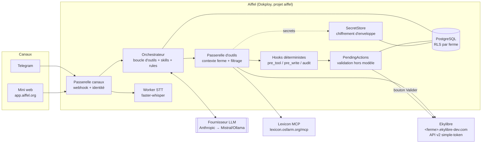
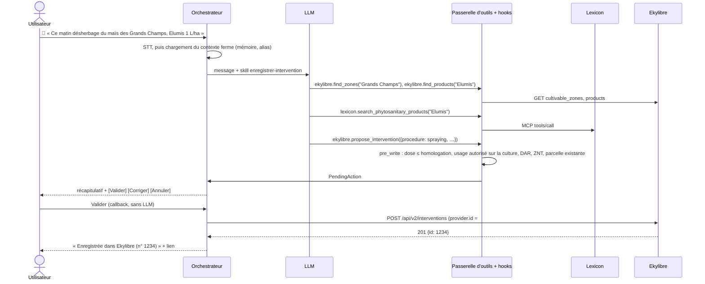
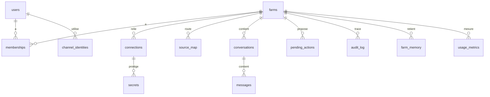

# Aiffel — Architecture de la phase 1

> Statut : proposition v0.1 (2026-10-24), à valider.
> Entrée : `docs/requirements.md` (§9, phase 1 : UC-1 et UC-2, Ekylibre + Lexicon, Telegram).
> Étape suivante : `/sc:workflow` (plan d'implémentation), puis `/sc:implement`.

## 1. Périmètre

| Inclus | Exclu (phases suivantes) |
|---|---|
| UC-1 : enregistrer une intervention par texte ou vocal sur Telegram, avec validation | Interface web complète (phase 2) |
| UC-2 : interroger ses données Ekylibre + Lexicon, avec citation des sources | Lyvre, PAC, compta (phase 3) |
| Appairage Telegram ↔ ferme et connexion à Ekylibre par `simple-token` (mini page web) | Logiciels propriétaires et coffre de mots de passe (phase 4) |
| Plusieurs fermes et plusieurs utilisateurs par ferme (exploitant, salarié) | Conseiller multi-fermes et délégation (phase 2) |
| Déploiement du prototype sur Dokploy (`app.aiffel.org`) | Mobile, marketplace, tâches planifiées (à partir de la phase 2) |

## 2. Décisions d'architecture (ADR)

### ADR-01 — Isolation : **routage central, isolation logique stricte** (pas de conteneur par ferme)
- Un seul service Aiffel sert toutes les fermes. Chaque tour de conversation s'exécute dans un
  **contexte de ferme** (`farm_id`) résolu à partir de l'identité du canal, puis propagé à toutes les
  couches : requêtes SQL filtrées, credentials, mémoire, logs.
- **L'agent n'a aucun outil générique** (pas de shell, pas de fichiers, pas de requêtes HTTP libres). Il
  n'a que les outils métier exposés par la passerelle d'outils, qui injecte elle-même le `farm_id`. Le modèle
  ne voit et ne choisit jamais d'identifiant de ferme.
- Postgres avec **Row-Level Security** sur les tables portant un `farm_id`, en défense en profondeur.
- *Pourquoi :* le pilote NanoClaw a montré le coût d'un conteneur par ferme (RAM × N, socket Docker = root
  sur un serveur partagé avec d'autres projets). Sans outil générique, l'isolation par conteneur n'apporte
  presque rien de plus.
- *Révisable :* une ferme auto-hébergée (coopérative) = une instance Aiffel, ce qui donne une isolation
  physique sans changer le code.

### ADR-02 — Moteur d'agent : **boucle d'outils maison sur l'API Messages**, pas Claude Agent SDK ni Hermes
- Une boucle d'outils explicite (appel du modèle → exécution des outils → nouvel appel), derrière une
  interface `LLMProvider` (Anthropic en phase 1 ; Mistral et Ollama ensuite, NF-SOUV).
- *Pourquoi :* l'Agent SDK apporte des outils Claude Code (Bash, Read, Edit…) qu'il faudrait désactiver un
  par un, et il est lié à un seul fournisseur. Hermes est mono-utilisateur, avec un shell (voir le
  brainstorm). Une boucle maison reste courte (environ 200 lignes), testable et multi-fournisseur.
- On garde le **format** des skills (markdown + frontmatter, compatible agentskills.io / ECC) pour rester portable.

### ADR-03 — Modèle ECC au runtime (version minimale)

| Brique | Phase 1 | Emplacement |
|---|---|---|
| **Agent** | Un seul agent « Assistant de ferme » (pas de sous-agents en phase 1 : latence et sobriété) | `runtime/agents/assistant/AGENT.md` |
| **Skills** | `enregistrer-intervention`, `consulter-donnees`, `rechercher-produit-phyto`, `expliquer-terme` ; chargées à la demande (seuls le nom et la description sont dans le prompt) | `runtime/skills/<nom>/SKILL.md` |
| **Rules** | Règles toujours chargées : jamais d'écriture sans validation, citer ses sources, dire « je ne sais pas », vouvoiement ou tutoiement selon la préférence, réponses courtes | `runtime/rules/*.md` |
| **Hooks** | Code Python **déterministe**, hors modèle : `pre_tool` (autorisation par rôle), `pre_write` (contrôles réglementaires, création de la proposition), `post_tool` (audit), `on_turn_end` (coût en tokens) | `aiffel/hooks/` |
| **Mémoire** | Faits par ferme (alias de parcelles, produits habituels, préférences) proposés par l'agent et **confirmés par l'utilisateur** avant d'être retenus | table `farm_memory` |

### ADR-04 — Écriture : **l'agent propose, le code exécute** (validation hors modèle)
- Les outils d'écriture ne font **jamais** l'écriture : ils créent une `PendingAction` (charge utile
  normalisée, résumé lisible, contrôles passés, empreinte, expiration de 24 h).
- Telegram affiche le résumé avec les boutons **Valider / Corriger / Annuler**. Le *callback* du bouton est
  traité par du code déterministe, **sans passer par le modèle** : contrôle du rôle (seul un utilisateur
  autorisé à écrire peut valider), de l'expiration et de l'empreinte, puis appel du connecteur.
- Idempotence : l'identifiant de la `PendingAction` sert de `provider.id` dans Ekylibre
  (`provider: {vendor: "aiffel", name: "assistant", id: <uuid>}`), ce qui fait du double-clic ou d'un
  nouvel essai une opération sans effet (déjà supporté par `POST /api/v2/interventions`).
- Un salarié peut proposer ; selon le réglage de la ferme, c'est lui ou l'exploitant qui valide (F-ECR-4).

### ADR-05 — Connecteurs : **interface d'outils de type MCP**, adaptateurs côté Aiffel
- Chaque connecteur expose une liste d'outils typés (nom, description, schéma JSON d'entrée et de sortie,
  `read`/`write`, portées requises) et déclare ses **capacités** (F-CON-3).
- **Lexicon** : client MCP direct vers `https://lexicon.osfarm.org/mcp` (serveur 1.6.0 : 15 outils,
  dont `search_phytosanitary_products`, `get_parcel`, `get_crop_history`, `get_input_price`). Les réponses
  sont mises en cache (limite de 30 requêtes par fenêtre) et l'outil restitue la licence pour la citer.
- **Ekylibre** : adaptateur **dans Aiffel**, qui appelle l'API REST v2. Pas de serveur MCP dans Ekylibre en
  phase 1 : Ekylibre est en Rails 5.2 / Ruby 2.6, et le SDK MCP Ruby récent s'y intègre mal. L'adaptateur
  pourra être extrait en serveur MCP autonome (`ekylibre-mcp`), réutilisable par d'autres, quand l'API sera stable.
- L'agent ne voit que des outils **filtrés** par les capacités de la ferme et le rôle de l'utilisateur.

### ADR-06 — Identifiants : **coffre minimal intégré** (chiffrement d'enveloppe), interface prête pour OpenBao
- Phase 1 : uniquement les `simple-token` Ekylibre et le jeton du bot Telegram (variable d'environnement).
  **Aucun mot de passe utilisateur n'est stocké** : il ne sert qu'une fois, pour obtenir le jeton (ADR-07).
- Une clé de données par ferme chiffre ses secrets (AES-256-GCM) ; cette clé est elle-même chiffrée par une
  clé maître (`AIFFEL_MASTER_KEY`, variable d'environnement Dokploy, puis KMS ou OpenBao). Les secrets sont
  déchiffrés **uniquement dans le connecteur, au moment de l'appel** : jamais dans le prompt, les logs ou les
  traces (F-VLT-2).
- Interface `SecretStore` (`get`, `put`, `rotate`, `revoke`) : l'implémentation OpenBao arrivera en phase 4,
  quand il faudra stocker des mots de passe pour les logiciels propriétaires.
- **OneCLI n'est pas retenu pour le cœur** : sous la forme utilisée dans le pilote, c'est un service
  externe (`app.onecli.sh`), incompatible avec l'auto-hébergement et la souveraineté (NF-DEP, NF-SOUV).

### ADR-07 — Ekylibre : **`simple-token` pour le prototype**, OAuth2 reporté (étude de faisabilité ci-dessous)

**Décision (2026-10-24)** : la phase de prototypage utilise le `simple-token` existant. On n'ajoute à
Ekylibre **que les endpoints de lecture nécessaires** (§7). OAuth2 est reporté.

**Étude de faisabilité d'OAuth2 (Doorkeeper) sur la pile actuelle**

| Élément | Constat |
|---|---|
| Pile | Ruby **2.6.6** (fin de vie : mars 2022), Rails **5.2.8.1** (fin de support : juin 2022), image `ruby2.6` |
| Doorkeeper récent (5.6.3 → 5.9.9) | Exige **Ruby ≥ 2.7** : impossible à installer |
| Dernière version installable | **5.6.2** (novembre 2022, `railties >= 5`), sans correctif depuis près de 4 ans |
| Vulnérabilité connue | **CVE-2023-34246** (GHSA-7w2c-w47h-789w, gravité moyenne) : consentement contourné pour les clients publics déjà approuvés, corrigée en 5.6.6 (Ruby 2.7). On pourrait l'éviter (Aiffel serait un client confidentiel, sans `skip_authorization`), mais on partirait d'une version vulnérable et figée |
| Multi-tenant `apartment` | Tables OAuth dans chaque schéma de tenant (migrations à jouer sur tous les tenants) ou dans `public` (exclusion de modèles : `excluded_models` est vide aujourd'hui, ce serait un premier cas), puis le flux de consentement par sous-domaine à tester |
| Travail estimé | 5 à 8 jours : gem, migrations multi-tenant, écran de consentement, page « Applications connectées », contrôle des portées dans `Api::V2::BaseController`, tests |

**Conclusion** : techniquement faisable, mais **déconseillé maintenant**. On ajouterait une brique
d'authentification figée et vulnérable sur une pile qui ne reçoit plus de correctifs de sécurité. OAuth2
doit venir **avec la montée de version d'Ekylibre** (Ruby ≥ 3.2, Rails ≥ 7.1), ou être porté par un
fournisseur d'identité externe (Keycloak, Authentik), à étudier à ce moment-là.

**Cible validée (2026-10-24)** : **Keycloak** comme fournisseur d'identité commun (OIDC/OAuth2) à Ekylibre,
Aiffel et aux futurs connecteurs. Il arrivera avec la refonte d'Ekylibre : modèle et méthodes métier
conservés, interface entièrement refaite en React. Une première tentative de migration globale (branche
`6.0-alpha`) a échoué : la refonte doit donc être progressive. Pendant le prototype, Aiffel isole
l'authentification Ekylibre derrière une interface (`EkylibreAuth`) pour pouvoir passer de `simple-token`
à un jeton Keycloak sans toucher aux outils.

**Limites du `simple-token` à connaître (constatées dans le code)**
- **Un seul jeton par utilisateur, partagé** par tous les clients (zero-mobile, Duke, Aiffel) :
  `tokens#create` ne le crée que s'il est vide (`app/controllers/api/v2/tokens_controller.rb`), et
  `DELETE /api/v2/tokens/:id` le remet à `nil`. **Une déconnexion côté mobile coupe donc Aiffel**, et inversement.
- Stocké **en clair** dans `users.authentication_token`, sans expiration ni portée : il donne tous les droits de l'utilisateur.
- On l'obtient avec l'email et le mot de passe (`POST /api/v2/tokens`).

**Mesures pour le prototype**
1. **Raccordement** : sur la mini page web d'Aiffel (HTTPS), l'utilisateur saisit l'adresse de sa ferme,
   son email et son mot de passe Ekylibre. Aiffel appelle `POST /api/v2/tokens` et **ne garde que le jeton**,
   chiffré (ADR-06). Le mot de passe n'est jamais stocké ni journalisé.
2. Aiffel **n'appelle jamais** `DELETE /api/v2/tokens` (ce qui déconnecterait les autres clients). Un
   `401` met la connexion en état « à reconnecter » et l'utilisateur est prévenu sur Telegram. Pendant
   un tour de l'agent, le refus est d'abord **confirmé par `users/me`** : confirmé, la connexion passe
   « à reconnecter » après la réponse ; sinon, c'est un refus d'accès à une donnée et la connexion reste
   active. Dans les deux cas, ce n'est qu'un échec de l'outil : le tour continue et les autres résultats
   (Pl@ntNet, Lexicon…) ne sont pas perdus.
3. **Moindre privilège côté Aiffel** : l'adaptateur n'expose que les outils de la phase 1 (§5). Aucun
   appel API hors de cette liste n'est possible, même si le jeton le permettrait.
4. Le prototype est **réservé aux fermes pilotes** (`demo` et quelques exploitations volontaires informées).
5. **Critère de sortie du prototype** : avant toute ouverture plus large, il faut des jetons à portée
   limitée. L'option intermédiaire la moins chère est une table `api_tokens` par tenant (empreinte du
   jeton, portées, expiration, révocation, libellé « Aiffel »), créée depuis le profil Ekylibre et vérifiée
   dans `Api::V2::BaseController`. C'est sans gem, environ 2 jours, compatible Ruby 2.6. Autre option :
   OAuth2 après la montée de version.

### ADR-08 — Duke : **pas de dépendance en phase 1, réutilisation de ses actifs**
- Aiffel n'appelle pas Duke au runtime en phase 1. Il reprend son **corpus d'évaluation**, sa **logique
  de correspondance Procedo** et son **analyse des dates en français**. Détails et justification au §8.

### ADR-09 — Pile technique : **Python 3.12**
- FastAPI (webhook Telegram, mini pages web de raccordement), `python-telegram-bot` (ou aiogram), SDK
  `anthropic`, SDK `mcp` (client), SQLAlchemy 2 + Alembic, PostgreSQL 16, `httpx`, Pydantic v2.
- Transcription vocale : `faster-whisper` (modèle *small*, CPU) dans un worker, auto-hébergé (NF-SOUV).
- File de tâches : table Postgres (`SELECT … FOR UPDATE SKIP LOCKED`) en phase 1, sans Redis.
- *Pourquoi Python :* même langage que Duke (réutilisation possible), SDK MCP et Anthropic officiels, et un
  écosystème IA et données riche.

## 3. Vue d'ensemble



Aiffel appelle Ekylibre **par son URL publique**, comme le ferait n'importe quelle autre instance : il
n'utilise pas le réseau Docker interne du staging. On garde ainsi la même isolation que pour une ferme externe.

## 4. Flux principaux

### 4.1 Appairage et connexion à Ekylibre (prototype, `simple-token`)
```mermaid
sequenceDiagram
  actor U as Exploitant
  participant T as Telegram
  participant A as Aiffel
  participant E as Ekylibre (demo.ekylibre-dev.com)
  U->>T: /start
  T->>A: webhook (chat_id inconnu)
  A-->>T: lien à usage unique app.aiffel.org/connect?c=XXXX (15 min)
  U->>A: ouvre le lien, saisit l'adresse de la ferme, son email et son mot de passe Ekylibre
  A->>E: POST /api/v2/tokens (email, mot de passe)
  E-->>A: {token}
  A->>E: GET /api/v2/users/me (simple-token + X-Tenant)
  A->>A: crée farm + membership + connection (jeton chiffré ; mot de passe oublié aussitôt), lie le chat_id
  A-->>T: « Connecté à la ferme Demo ✅ »
```
- Un deuxième utilisateur (salarié) de la même ferme suit le même parcours avec **son propre compte
  Ekylibre** : ses droits Aiffel découlent de ses droits Ekylibre.
- La liste blanche est implicite : un `chat_id` non appairé ne reçoit que l'invitation à se connecter.

### 4.2 UC-1 — Enregistrer une intervention

- Un blocage (dose hors homologation) empêche la validation : il faut corriger. Un avertissement
  (météo, DAR proche) laisse valider, avec mention dans l'audit.
- « Corriger » relance une conversation sur la proposition en cours, qui reste la même `PendingAction` versionnée.

### 4.3 UC-2 — Interroger ses données
- Outils de lecture seulement, sans validation. La réponse indique **toujours** ses sources
  (« Ekylibre, interventions 2026 ; Lexicon, E-Phy (ANSES), licence Etalab »).
- Aiffel refuse d'extrapoler quand la donnée manque (NF-IAC-3).
- Les calculs (sommes, unités, doses par hectare) sont faits par des **outils de calcul déterministes**,
  pas par le modèle.

## 5. Outils exposés à l'agent (phase 1)

| Outil | Source | R/W | Portée |
|---|---|---|---|
| `ekylibre.find_zones(query)` | `GET /cultivable_zones` (+ alias de la mémoire) | R | `zones:read`¹ |
| `ekylibre.find_products(query, type)` | `GET /products/:type` | R | `products:read` |
| `ekylibre.list_procedures()` / `get_procedure(name)` | `GET /procedures` | R | — |
| `ekylibre.search_interventions(filters)` | **nouvel endpoint** (§7) | R | `interventions:read` |
| `ekylibre.input_totals(filters)` | **nouvel endpoint** (§7) | R | `interventions:read` |
| `ekylibre.farm_profile(year)` | `GET /farm_profiles/:year` | R | `farm:read` |
| `ekylibre.propose_intervention(draft)` | crée une `PendingAction` (hook `pre_write`) | W* | `interventions:write` |
| `lexicon.*` (sélection) | MCP Lexicon | R | public |
| `calc.*` (somme, conversion d'unités, dose/ha) | local | — | — |
| `memory.propose_fact(fact)` | `farm_memory` (après confirmation) | W* | — |

\* Écriture **différée** : elle n'a lieu qu'après validation hors modèle (ADR-04).
¹ Les portées sont appliquées **côté Aiffel** pendant le prototype (le `simple-token` n'en a pas) ; elles serviront telles quelles quand Ekylibre aura des jetons à portée limitée.

## 6. Modèle de données (Postgres, schéma `aiffel`)



| Table | Champs principaux |
|---|---|
| `farms` | `id`, `name`, `data_key_enc`, `settings` (validation par l'exploitant, langue, ton) |
| `users` / `memberships` | utilisateur ; rôle (`owner`, `worker`) par ferme |
| `channel_identities` | `channel` (`telegram`), `external_id_hash`, `user_id`, `paired_at` |
| `pairing_codes` | code à usage unique, expiration, `channel_identity` en attente |
| `connections` | `farm_id`, `connector` (`ekylibre`), `base_url`, `tenant`, `scopes`, `status`, `user_id` (compte Ekylibre associé) |
| `secrets` | `connection_id`, `kind`, `ciphertext`, `nonce`, `rotated_at` |
| `source_map` | `farm_id`, `data_type`, `connection_id`, `read`, `write` (F-CON-4) |
| `conversations` / `messages` | historique ; rétention configurable (90 jours par défaut, à valider avec la RGPD) |
| `pending_actions` | `id` (uuid), `farm_id`, `proposed_by`, `connector`, `payload`, `summary`, `checks`, `hash`, `status`, `version`, `expires_at`, `external_ref` |
| `audit_log` | **ajout seul** (droits `INSERT` uniquement, chaînage par empreinte) : qui, quoi, où, validé par, résultat |
| `farm_memory` | `farm_id`, `kind` (`alias`, `habit`, `preference`), `content`, `source`, `confirmed_by`, `confirmed_at` |
| `usage_metrics` | `farm_id`, `day`, `tokens_in`, `tokens_out`, `model`, `stt_seconds` (NF-SOB) |

## 7. Évolutions requises dans Ekylibre (branche `5.0-beta`)

Phase de prototypage : **uniquement des endpoints de lecture**. On ne touche pas à l'authentification (ADR-07).

1. **Interventions réalisées** : `GET /api/v2/intervention_records`. L'actuel `GET /api/v2/interventions`
   est orienté vers les demandes en cours (mobile). Filtres : période, parcelle ou production, procédure,
   intrant, campagne ; pagination.
2. **Agrégats d'intrants** : `GET /api/v2/input_totals` (quantités et unités par production, campagne et
   intrant), pour répondre par exemple à « combien d'azote sur mes blés ».
3. **Productions de la campagne** : `GET /api/v2/activity_productions?campaign=` (culture, surface, parcelles).
4. Pour chacun : documentation dans `docs/api/openapi-v2.yaml` et tests Minitest.

Ces endpoints profitent aussi à zero-mobile et à Duke (qui pourrait abandonner sa lecture directe de la
base, §8). Ils restent à valider avec l'équipe Ekylibre.

## 8. Place de Duke (ADR-08)

Constat (dépôt `/home/djoulin/projects/duke`, v0.1.0, 152 tests) :
- FastAPI + WebSocket ; NLU hybride : intention par regex, spaCy `fr_core_news_lg` + EntityRuler, extraction
  par LLM avec tool calling, routeur Claude/Mistral/Ollama, transcription faster-whisper.
- **Il lit la base Ekylibre en direct** (asyncpg en lecture seule, `SET LOCAL search_path` par tenant,
  `src/duke/integration/ekylibre/read_db.py:46`). Il n'écrit que par l'API v2, avec `simple-token`.
- La logique d'enrichissement des brouillons et l'état de clarification sont dans le handler WebSocket
  (`ws_server.py`, environ 1 350 lignes). Le passer en serveur MCP sans état demanderait environ 2 à 4 jours.

**Décision : Aiffel ne dépend pas de Duke au runtime en phase 1.**
- Un accès direct à la base est **incompatible avec le principe d'Aiffel** : se connecter à n'importe quelle
  instance Ekylibre (SaaS ou auto-hébergée) par son API, sans jamais avoir de DSN de base.
  Ce point reste vrai même si Aiffel utilise lui aussi `simple-token` pendant le prototype.
- **Ce qui est réutilisé** dans Aiffel :
  1. le **corpus de 267 phrases** (`tests/fixtures/golden_phrases.yaml`), comme jeu d'évaluation de UC-1
     (objectif : au moins autant de bonnes extractions que Duke) ;
  2. la **correspondance brouillon → charge utile Procedo** (`integration/ekylibre/mappers.py:110`,
     `procedure_registry.py`), portée dans l'adaptateur Ekylibre d'Aiffel ;
  3. l'**analyse des dates en français** (`nlu/temporal.py`) et les prompts d'extraction, comme point de départ ;
  4. la configuration faster-whisper.
- **Convergence possible** : les nouveaux endpoints de lecture du §7 (`intervention_records`,
  `input_totals`, `activity_productions`) permettraient à Duke d'abandonner l'accès direct à la base. Duke
  pourrait alors devenir un **agent du catalogue Aiffel** exposé en MCP (`draft_intervention`,
  `ask_farm_data`). On comparera les deux approches sur le corpus avant de décider (phase 2).

## 9. Sécurité

| Menace | Mesure |
|---|---|
| Injection de prompt (message Telegram, contenu Lexicon ou Ekylibre) | Pas d'outil générique ; les outils d'écriture ne font que proposer ; validation hors modèle ; les données d'outils sont marquées comme données, jamais comme instructions |
| Usurpation d'un utilisateur Telegram | Appairage par lien à usage unique + identifiants Ekylibre ; `chat_id` haché avec sel ; secret du webhook (`X-Telegram-Bot-Api-Secret-Token`) |
| Fuite entre fermes | `farm_id` injecté par la passerelle, RLS Postgres, tests d'isolation automatisés (ferme A ne lit jamais B) |
| Vol de jetons Ekylibre | Chiffrement d'enveloppe ; outils limités côté Aiffel ; fermes pilotes uniquement ; jetons à portée limitée avant toute ouverture (ADR-07) |
| Serveur partagé avec d'autres projets | Aucun socket Docker, aucun port exposé hors Traefik, utilisateur non root, réseau Docker propre à Aiffel |
| Validation détournée | Le bouton Valider vérifie le rôle, l'expiration et l'empreinte de la proposition ; l'idempotence empêche les doublons |
| Logs | Ni contenu utilisateur, ni jeton, ni email ; identifiants hachés |

## 10. Déploiement du prototype

- **Dokploy**, projet `aiffel`, environnement `production` : une application *compose* avec
  - `aiffel-app` (FastAPI : webhook Telegram, mini web, orchestrateur) ;
  - `aiffel-worker` (STT faster-whisper et tâches en file) ;
  - `aiffel-db` (PostgreSQL 16, volume sauvegardé).
- **DNS Gandi** : `app.aiffel.org` (A/AAAA vers le serveur `lavz`), avec HTTPS par Traefik/Let's Encrypt
  via Dokploy. **À créer uniquement avec ton accord** (exposition publique).
- **Telegram** : un bot dédié créé via BotFather (`@AiffelBot` ou équivalent), en mode webhook.
- **Secrets** (variables Dokploy) : `TELEGRAM_BOT_TOKEN`, `TELEGRAM_WEBHOOK_SECRET`, `ANTHROPIC_API_KEY`,
  `AIFFEL_MASTER_KEY`, `DATABASE_URL`.
- **Ressources estimées** : environ 2 Go de RAM (dont environ 1 Go pour Whisper *small*), sur les 23 Go disponibles.
- **Ferme de test** : `demo.ekylibre-dev.com`, une fois les nouveaux endpoints (§7) déployés sur le staging.

## 11. Correspondance avec les exigences

| Exigence | Couverte par |
|---|---|
| F-CAN-1, F-CAN-4 | Passerelle canaux, `channel_identities` (web en phase 2) |
| F-CON-3, F-CON-4 | ADR-05, `source_map` |
| F-CON-5, F-CON-8, F-CON-9 | Lexicon MCP, adaptateur Ekylibre, §7 |
| F-AGT-1 à F-AGT-4 | ADR-03 (un agent et des skills ; catalogue en phase 2) |
| F-ECR-1 à F-ECR-4 | ADR-04 |
| F-VLT-1 à F-VLT-3 | ADR-06, ADR-07 |
| F-MEM-1, F-MEM-2 | `farm_memory` avec confirmation |
| NF-SEC-1 à NF-SEC-3 | §9, ADR-01 |
| NF-IAC-1 à NF-IAC-3 | Citation des sources, validation, outils de calcul, rule « je ne sais pas » |
| NF-SOB, NF-SOUV | `usage_metrics`, `LLMProvider` multi-fournisseur, Whisper local |

## 12. Points ouverts

1. Calendrier de la montée de version d'Ekylibre (Ruby/Rails), qui conditionne OAuth2 ; d'ici là, faut-il faire la table `api_tokens` (environ 2 jours) ?
2. Fournisseur LLM de la phase 1 (proposition : Claude Sonnet pour l'agent, Haiku pour les tâches simples, Mistral en option).
3. Durée de rétention des conversations (RGPD).
4. Validation des nouveaux endpoints par l'équipe Ekylibre.
5. Le nom du bot Telegram.
